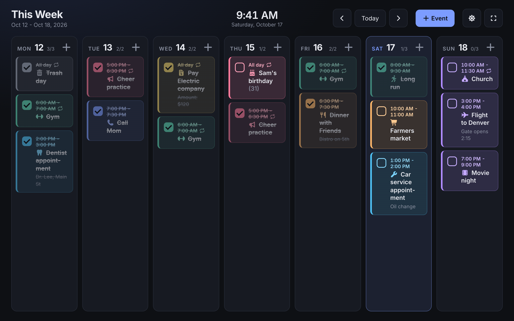
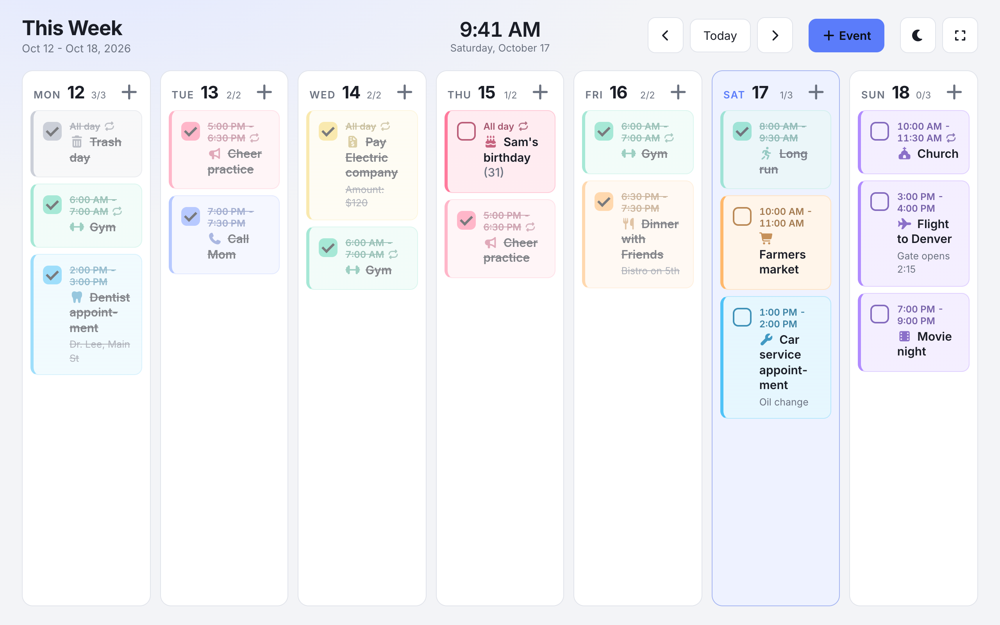
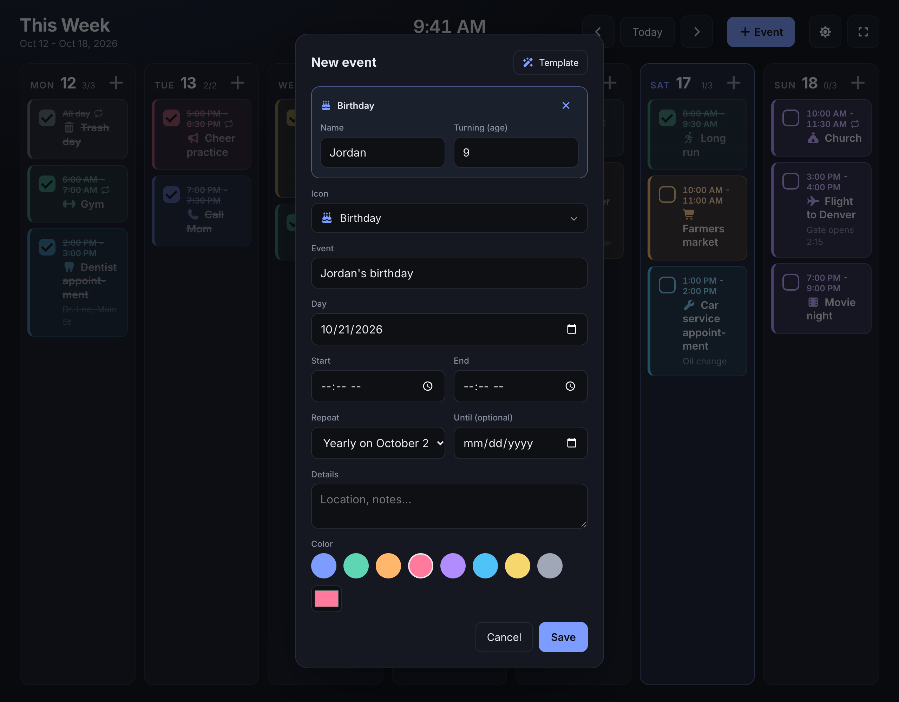
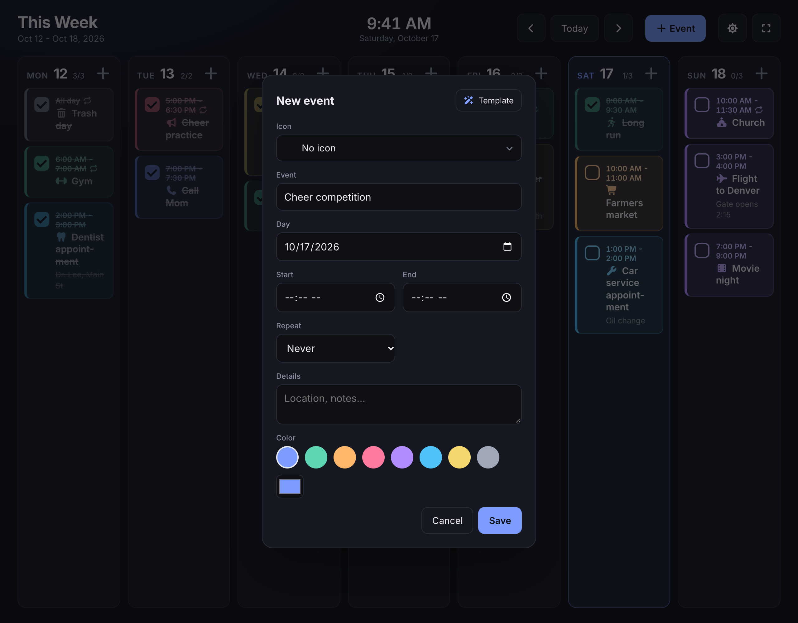
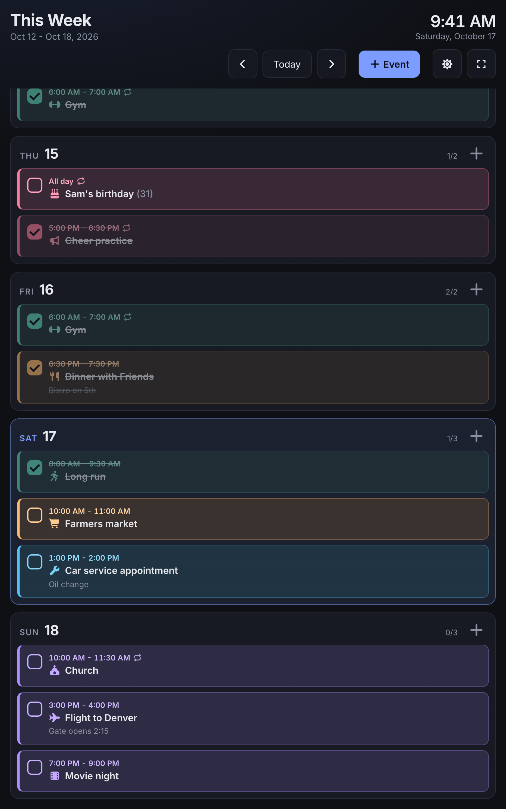

# Week Board

A self-hosted weekly calendar laid out as a kanban board, built to run full screen on a wall-mounted touchscreen tablet. Each day is a column, each event is a color-coded card with a time, icon and a checkbox to mark it done.



## Features

- **Week at a glance**: Monday to Sunday columns, today highlighted, live clock, previous/next week navigation.
- **Event cards**: time range, title, details, Font Awesome icon and a per-event color. Tick the checkbox to strike an event through; each day shows how many are done.
- **Touch first**: tap a card to edit it, long-press and drag to move it to another day, finger-sized buttons, full-screen mode. Works with a mouse too.
- **Recurring events**: daily, weekdays, weekly or every 2 weeks on chosen days, monthly by date, by weekday (e.g. 2nd Tuesday or last Friday), or yearly. Edit or delete one occurrence or the whole series. Each occurrence is checked off separately.
- **Templates**: Birthday, Anniversary, Appointment, Workout, Bill due, Dinner plans, Trip, Call and Medication. Answer a couple of questions and the title, icon, color, time and repeat are filled in. Birthdays show the right age every year.
- **Sensible defaults**: picking a start time sets the end an hour later; moving the start keeps the event's length.
- **Light and dark themes**, remembered per device.
- **Server-side storage**: events live in a Docker volume on the server, so they survive restarts, rebuilds and power cuts, and every device sees the same calendar (open boards refresh every 30 seconds).
- **HTTPS out of the box** with a generated self-signed certificate, or bring your own.
- **Optional auto-deploy**: the server can pull this repo and rebuild whenever `main` changes.

## Screenshots

| Light theme | Event templates |
| --- | --- |
|  |  |

| Icon picker | Tablet, portrait |
| --- | --- |
|  |  |

## Quick start (Docker)

Requires Docker with the Compose plugin.

```bash
git clone https://github.com/HauptSec/kanban-calendar.git
cd kanban-calendar
TLS_SAN=IP:192.168.1.50 docker compose up -d --build
```

Replace `192.168.1.50` with the address you'll use to reach the server, then open `https://192.168.1.50:8001`. The certificate is self-signed, so each browser shows a warning once; accept it to continue.

Plain `http://` requests to port 8001 are redirected to HTTPS.

## Configuration

### Certificate names (`TLS_SAN`)

On first start the web container generates a self-signed certificate covering `localhost`, `127.0.0.1` and anything listed in `TLS_SAN` (comma-separated, e.g. `DNS:weekboard.local,IP:192.168.1.50`). Put it in a `.env` file next to `docker-compose.yml` so you don't have to pass it every time:

```bash
echo "TLS_SAN=IP:192.168.1.50" > .env
```

The certificate is kept in the `certs` volume. To regenerate it after changing `TLS_SAN`, remove the volume and start again:

```bash
docker compose down
docker volume rm kanban-calendar_certs
docker compose up -d
```

Only the `certs` volume is removed; your events are in a separate volume.

### Using your own certificate

Copy a PEM certificate and key into the running container, then restart it:

```bash
docker cp cert.pem weekboard:/etc/nginx/certs/cert.pem
docker cp key.pem weekboard:/etc/nginx/certs/key.pem
docker restart weekboard
```

Existing files in the volume are never overwritten.

## Data and backups

All events are stored as a single JSON file, `/data/events.json`, in the `kanban-calendar_data` volume of the `weekboard-api` container. Writes are atomic (temp file, fsync, rename), so a crash or power cut leaves either the previous or the new version on disk.

Back up:

```bash
docker cp weekboard-api:/data/events.json events-backup.json
```

Restore:

```bash
docker cp events-backup.json weekboard-api:/data/events.json
```

## Auto-deploy from GitHub (optional)

The server can poll this repository and rebuild whenever `main` changes. This works on a private network with no inbound access from GitHub. It assumes the repo is cloned to `~/kanban-calendar` and that your user can run `docker` without `sudo`.

```bash
mkdir -p ~/.config/systemd/user
cp ~/kanban-calendar/deploy/weekboard-deploy.service ~/kanban-calendar/deploy/weekboard-deploy.timer ~/.config/systemd/user/
systemctl --user daemon-reload
systemctl --user enable --now weekboard-deploy.timer
sudo loginctl enable-linger "$USER"
```

The last command keeps the timer running when you're not logged in. Every 2 minutes it runs [`deploy/auto-deploy.sh`](deploy/auto-deploy.sh), which fetches `main` and, if it moved, hard-resets the checkout and runs `docker compose up -d --build`. Treat the server checkout as deploy-only: local edits to tracked files are discarded.

```bash
journalctl --user -u weekboard-deploy -n 50
~/kanban-calendar/deploy/auto-deploy.sh --force
```

The first shows deploy history; the second rebuilds right away. If you change the unit files in `deploy/`, copy them again and run `systemctl --user daemon-reload`.

## Using it on a tablet

The board is designed for a 10" tablet on the wall (developed against an Amazon Fire HD 10).

- Use **landscape** for the full seven-column week; portrait and phones get a stacked list.
- **Tap** a card to edit it, **tap the checkbox** to mark it done, **press and hold** a card then drag to move it to another day.
- The **+** on each day adds an event on that day; **+ Event** in the header adds one for today (or the Monday of the week you're viewing).
- Tap the full-screen button to hide the browser bar. For a permanent display, a kiosk browser (for example Fully Kiosk Browser) can lock the screen to the page and keep it awake.
- Event icons load from the cdnjs CDN, so the tablet needs internet access for icons. Everything else is served by your server.

Supported browsers: current Chrome, Edge, Firefox and Safari, plus older Chromium-based tablet browsers back to about Chrome 84 (including Amazon Silk on Fire OS).

## Development

No build step and no dependencies beyond Python 3. The API server also serves the page, so for local work:

```bash
python3 api/server.py
```

Then open `http://localhost:8000`. Events are stored in `.data/` (git-ignored). Set `PORT` or `DATA_DIR` to change either.

Tests:

```bash
python3 api/test_server.py
```

This exercises the API against a temporary data directory. Open the app with `#selftest` at the end of the URL (e.g. `http://localhost:8000/#selftest`) and check the browser console for `selftest passed` to run the recurrence and time checks.

## How it works

```
Browser ──HTTPS:8001──▶ weekboard (nginx) ── serves index.html
                              │
                              └── /api/ ──▶ weekboard-api (Python) ──▶ /data/events.json
```

| Path | Purpose |
| --- | --- |
| [`index.html`](index.html) | The entire front end: markup, styles and script in one file. |
| [`api/server.py`](api/server.py) | Standard-library Python API that stores events. |
| [`nginx.conf`](nginx.conf) | TLS on port 8001, HTTP-to-HTTPS redirect, `/api/` proxy. |
| [`docker/10-self-signed-cert.sh`](docker/10-self-signed-cert.sh) | Generates the certificate on first start. |
| [`docker-compose.yml`](docker-compose.yml) | The two containers and their volumes. |
| [`deploy/`](deploy/) | Optional auto-deploy script and systemd timer. |

API:

| Method | Path | Description |
| --- | --- | --- |
| `GET` | `/api/events` | List all events. |
| `PUT` | `/api/events/<id>` | Create or replace one event (JSON body, `id` must match). |
| `DELETE` | `/api/events/<id>` | Delete one event. |

There is no authentication: anyone who can reach port 8001 can view and edit the calendar. Run it on a network you trust.
